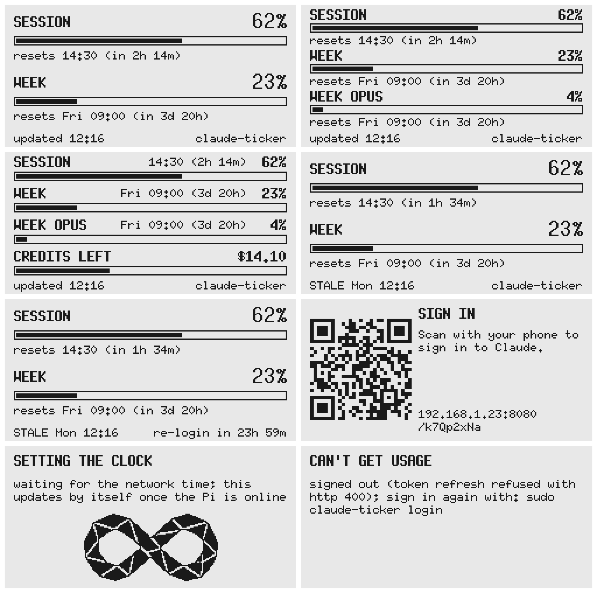

# AGENTS.md — claude-ticker

Instructions for coding agents working in this repository. Read this file before making changes. If a request conflicts with a rule here, stop and ask; do not quietly break the rule.

> Using Claude Code? Copy or symlink this file to `CLAUDE.md` (`ln -s AGENTS.md CLAUDE.md`).

---

## 1. What this project is

A small Rust program that runs on a **Raspberry Pi Zero / Zero 2 W** with a **Waveshare 2.13" e-Paper HAT** (250×122 pixels, black and white, revision V2/V3/V4). It shows the owner's **Claude Pro/Max plan usage** on a single dashboard:

1. The rolling 5-hour **session** limit: percent used and when it resets.
2. The **weekly** limit across all models: percent used and when it resets.
3. A **model-specific weekly** limit (e.g. Opus), only when the plan has one.
4. **Usage credits** ("extra usage"): the amount left under the monthly spending cap, only when credits are turned on. Added at the owner's request on 2026-10-31.

Each limit is a row with a progress bar. A footer shows when the numbers were fetched, and marks them `STALE` when old.

It is a repurposed copy of `bump-ticker`, a pregnancy tracker on the same hardware. The layering, e-paper handling and deployment carried over unchanged.

### Explicit non-goals

Do **not** add these unless the project owner asks for them in writing:

- Anything that reads or shows prompts, conversations or other account content. Only the usage numbers are fetched.
- Account management beyond signing in: changing plans, buying credits, switching organisations. (Signing in from the Pi, by QR code or `claude-ticker login`, was added at the owner's request.)
- Cloud services, telemetry or analytics. The only network traffic is the usage API, sign-in and token refresh, NTP, and the local sign-in page while it is open.
- A ticker or rotating pages. The owner asked for one dashboard. Ticker support was removed in the conversion.
- A desktop GUI for end users, or animation or scrolling (see §5). The `simulator` feature (§7) is a **developer tool** that mimics the panel. It is not a product UI.

---

## 2. Architecture

The crate is layered from pure logic to hardware. **Dependencies only point downward**, toward the pure layers. Never import a hardware or network layer from a pure one.

```text
usage       pure: API JSON → Usage → Status (rows, resets, staleness). No I/O, no clock.
source      UsageSource and Portal traits + errors. Pure; lets app be tested with fakes.
config      TOML → credentials path + display settings. Validates at load time.
view        Status → pixels on any DrawTarget<Color = BinaryColor>.
framebuffer 1-bit in-memory canvas that the view draws into.
panel       Panel trait ("put this frame on glass") + RefreshPolicy.
app         The loop: Clock → fetch → Status → view → Panel → sleep.
api         UsageSource over HTTPS, token refresh, login (feature "net"; "epd" implies it)
web         Portal: the phone sign-in page on the LAN    (feature "web"; "epd" implies it)
epd         Panel for the real HAT                      (feature "epd", Linux only)
preview     Panel that writes PNG files                 (feature "preview")
simulator   Panel in a desktop SDL window               (feature "simulator")
main.rs     CLI entry point; thin wiring only.
examples/   preview.rs, simulator.rs, logo.rs: dev tools.
```

| Module | May depend on | Must never depend on |
|---|---|---|
| `usage` | `chrono`, `serde_json` | anything else in the crate |
| `source` | `usage`, `chrono` | `api`, `view`, `panel`, `app`, hardware |
| `config` | `serde`, `toml`, `chrono-tz` | `view`, `panel`, `app`, `api`, hardware |
| `view` | `usage`, `embedded-graphics`, `qrcodegen` | `framebuffer` concretely, `panel`, `app`, hardware |
| `framebuffer` | `embedded-graphics` | everything else |
| `panel` | `framebuffer`, `chrono` | `view`, `app`, hardware crates |
| `app` | all of the above | `api`, `rppal`, `epd-waveshare`, `image`, `ureq` |
| `api` | `source`, `usage`, `ureq`, `ring`, `serde_json` | `view`, `panel`, `app`, `config` |
| `web` | `source`, `api`, `chrono`, `std::net` | `view`, `panel`, `app`, `config` |
| `epd` | `panel`, `framebuffer`, `rppal`, `epd-waveshare` | `view`, `app`, `config` |
| `preview` | `panel`, `framebuffer`, `image` | `view`, `app`, `config` |
| `simulator` | `panel`, `framebuffer`, `embedded-graphics`, `embedded-graphics-simulator` | `view`, `app`, `config` |

Rules that follow from this:

- `view` draws onto a **generic** `DrawTarget<Color = BinaryColor>`, so it runs against the framebuffer, a PNG or the simulator.
- `app` talks to the outside world only through the `Panel`, `Clock`, `UsageSource` and `Portal` traits. That is what makes it testable with fakes.
- Hardware crates (`rppal`, `epd-waveshare`) stay behind `epd`, the HTTP client (`ureq`) behind `net`, and the sign-in page behind `web`. `cargo build` and `cargo test` with **no features** must work on any Linux, macOS or Windows machine.
- `rppal` only compiles on Linux, so the `epd` module is gated on `all(feature = "epd", target_os = "linux")`. On other hosts `--features epd` builds everything else, and `main` falls back to `--check` behaviour.
- The SDL2-based simulator stays behind `simulator`.

---

## 3. Domain rules (correctness-critical)

These live in `src/usage.rs`, and each has a unit test there. `tests/usage_api.rs` checks them end to end against a real captured response. Keep them passing, and add a test for any new rule.

### The data source

- Endpoint: `GET https://api.anthropic.com/api/oauth/usage`, with `Authorization: Bearer <access token>` and `anthropic-beta: oauth-2025-04-20`. Claude Code's `/usage` uses the same endpoint. It is **undocumented** and can change without notice.
- `tests/fixtures/usage-pro.json` is a real Pro-account response captured on 2026-10-23, with credits off. `tests/fixtures/usage-credits.json` is a real response captured on 2026-10-31 with credits on (A$25.90 of a A$40.00 monthly cap). If the shape changes, capture a new response with `claude-ticker --raw` and keep the old one as a regression case.

### Parsing (tolerant by design)

- Every field is optional and unknown fields are ignored. Do **not** add `deny_unknown_fields` here; that rule is for config only.
- Session: `five_hour.utilization`, falling back to the `limits[]` entry with `kind = "session"` (`percent`).
- Weekly: `seven_day.utilization`, falling back to `limits[kind = "weekly_all"]`.
- Model row: the first non-null of `seven_day_opus`, then `seven_day_sonnet`, then any `limits[kind = "weekly_<model>"]`. Its label is `WEEK <MODEL>`.
- Credits row (`CREDITS LEFT`, always last): `extra_usage` when `is_enabled` is true (`used_credits` and `monthly_limit` in minor units, with `currency` and `decimal_places`), falling back to `spend` when `enabled` is true (`used` and `limit`, each `{amount_minor, currency, exponent}`). It needs a cap above zero; otherwise there is no row. Other objects in the response (`iguana_necktie`, other codenamed fields) are not limits and must not become rows.
- A response with neither a session nor a weekly limit is a `ParseError::NoLimits`. A `resets_at` that is missing or invalid becomes `Reset::Unknown`, not an error.

### Display rules

- Percent: rounded, then clamped to 0–100.
- Reset: once `now >= resets_at`, the row shows **0%** and "reset at HH:MM; updating" until the next fetch.
- Time left (`Span`): `14m`, `2h 14m`, `3d 4h`. Part minutes round **up**, and a span is never negative.
- Reset lines: `resets 14:30 (in 2h 14m)` when under a day away, otherwise `resets Fri 09:00 (in 3d 20h)`.
- Sign-in warning: when the refresh token expires within `SIGN_IN_WARNING` (5 days), the footer shows `re-login in <span>` (`usage::sign_in_warning`, filled in by `app` from `UsageSource::sign_in_expires`). Unknown expiry means no warning.
- Hostname: otherwise the footer's right side shows the device's hostname (`Status::host`, filled in by `app` from `App::with_host`; `main` reads `/proc/sys/kernel/hostname`). The sign-in warning takes its place when due. Non-ASCII and whitespace characters are dropped, and it is cut short to keep two characters clear of the left text (22 characters next to `STALE Mon 12:16`).
- Credits: the row shows the amount left (cap − spent, never negative, e.g. `$14.10`) where other rows show a percentage, and its bar is the share *remaining* (`Row::percent` is percent remaining for this row only). The line under the bar is `of $40.00 monthly limit`. This is the spend limit, not the prepaid balance shown on the claude.ai usage page, which the API does not return (`spend.balance` is null, checked 2026-10-31). `$` is used for USD, AUD, CAD, NZD, SGD and HKD; other currencies are written as their code (`EUR 14.10`), since the fonts are ASCII-only. The API gives no date for the cap's reset, so none is shown.
- Staleness: data older than `stale_minutes` is flagged `STALE`. Data older than `STALE_LIMIT_FACTOR` (6) × `stale_minutes` is `StatusError::Stale`, and the error screen replaces the numbers.

### Errors in the loop (`app`)

- A failed fetch keeps the last good numbers on screen, because Wi-Fi blips are normal.
- Errors where `SourceError::needs_attention()` is true (missing or bad credentials, signed out, cannot save) replace the numbers **at once** with the error screen.
- With no data at all, the app retries after `ERROR_RETRY` (60 s) instead of the full poll interval.
- **Signing in:** when a fetch fails with `SourceError::needs_sign_in()` (no credentials, or `Auth`) and the app has a `Portal`, it opens the portal and shows `Screen::SignIn` (a QR code of the page's address). While that screen is up it checks `Portal::take_completed` every `SIGN_IN_POLL` (3 s) without fetching, fetches immediately once a sign-in completes (or at the normal poll interval, in case someone used `claude-ticker login`), and closes the portal after the first good fetch. If the portal cannot open (no network), the plain error screen shows and opening is retried on the next fetch. Network and HTTP errors never open it.
- It must **never panic** or show garbage numbers.

### Credentials (`api`)

- **Login** (`claude-ticker login`, `api::Login`): OAuth authorization code with PKCE (S256), through Claude Code's public client and its "manual" redirect (`https://platform.claude.com/oauth/code/callback`), which shows a `code#state` string to paste back. Authorize at `https://claude.com/cai/oauth/authorize` with `LOGIN_SCOPES`; exchange at the token URL with `grant_type: "authorization_code"`. Verify the pasted state matches. The flow was read from Claude Code 2.1.309; it is undocumented.
- The file uses Claude Code's own layout (`{"claudeAiOauth": {"accessToken", "refreshToken", "expiresAt" (ms), "refreshTokenExpiresAt" (ms), "scopes", ...}}`), so a copy of the macOS Keychain item `Claude Code-credentials` also works. Preserve unknown fields when rewriting it.
- Refresh with `POST https://platform.claude.com/v1/oauth/token` and the JSON body `{grant_type: "refresh_token", refresh_token, client_id, scope}`, using Claude Code's public client id. Refresh 5 minutes before `expiresAt`, and once on a 401.
- **The refresh token rotates.** Write the new pair back atomically (temp file, then rename), mode 0600, keeping the original owner (or, for a new file, the directory's owner, so `sudo claude-ticker login` writes a file the service's dynamic user can read). Never refresh against a credentials file that another live client (the Mac) is also using. The Pi needs its own sign-in chain, which `login` gives it.
- **Phone sign-in page** (`web::WebPortal`): plain `std::net`, one request at a time, running **only** while the sign-in screen is up. Each opening listens on `sign_in_port` with a fresh random 8-character path (`http://<lan-ip>:<port>/<token>`); anything else gets a 404, so only someone who can see the panel can use it. `GET` starts a `Login` and links to Claude; `POST` takes the pasted `code#state` and calls `Login::finish`; mistakes re-show the form with the message. After one success the page refuses further sign-ins until reopened. The LAN address comes from the routing table (a connected UDP socket; nothing is sent). Pages are self-contained HTML, with no external assets or scripts.
- `ApiSource` re-reads the file whenever its modification time changes, so a `login` while the service runs takes effect at the next fetch without a restart.
- Never log or display tokens.

---

## 4. Configuration

Default path: `/etc/claude-ticker/config.toml`. Pass a different path as a CLI argument to override it. `claude-ticker --check [PATH]` validates the config, fetches usage once and prints it with the sign-in expiry, without touching the display. `claude-ticker --raw [PATH]` fetches once and prints the API's JSON body unparsed, for capturing new response shapes as fixtures (§3). `claude-ticker login [PATH]` signs in and writes the credentials file the config names. The example shipped to new installs is `deploy/config.toml`; unit tests keep it valid and equal to the defaults, so update it when you add fields.

```toml
timezone = "Australia/Sydney"  # optional IANA name; omit for the OS timezone. Must be above any [section].

[account]
credentials = "/var/lib/claude-ticker/credentials.json"
sign_in_port = 8080         # phone sign-in page when signed out; 0 = off, else 1024 or above

[display]
poll_seconds = 300          # how often to fetch; minimum 60
stale_minutes = 15          # flag STALE after this; must cover at least one poll
full_refresh_every = 12     # partial refreshes between full refreshes; minimum 1
flipped = false             # rotate 180° if the Pi is mounted upside down
```

Every key is optional and defaults to the values shown.

- Use `#[serde(deny_unknown_fields)]` on every config struct, so typos fail loudly.
- Validate everything in `Config::from_toml`, so a bad config fails at startup, not on first render.
- Adding a field: give it a `Default`, document it in the doc comment at the top of `src/config.rs` **and** in this file, and add a test.
- Credentials are **not** in the config, only their path. The app rewrites that file; it never rewrites the config.

---

## 5. E-paper constraints (read before touching `view`, `panel` or `app`)

The display is **not** an LCD. Designs that assume one will look bad or wear out the panel.

- **Full refresh** (`Refresh::Full`): about 2 s, flashes black/white, clears ghosting.
- **Partial refresh** (`Refresh::Partial`): about 0.3 s, no flash, but leaves faint ghosts. Waveshare requires a full refresh after several partials.
- **No animation or scrolling.**
- **Minimum poll interval is 60 s** (`MIN_POLL_SECONDS`). Do not lower it. It protects both the panel and the API.
- **Refresh policy lives in `RefreshPolicy`**, not in `app` or `epd`. It forces `Full` on: the first frame, the first frame of each new local day, after `full_refresh_every` partials, and after the panel has slept (`force_full`).
- **Unchanged frames are not sent.** `App` compares the new frame with what is on glass and skips the panel if they are identical.
- **Sleep:** the dashboard keeps the controller awake, so updates can use partial refresh. The error and waiting screens put it to sleep after drawing (the image stays on screen at zero power). After `sleep`, the next `present` must re-initialise the controller; `EpdPanel` tracks this with its `asleep` flag.
- **1-bit only.** Black or white; no greys, no dithering, no anti-aliased fonts.

### Layout rules (250×122, landscape)

- 8 px side margin (`MARGIN`). Nothing may be clipped at the edges. Right-aligned text anchors at `TEXT_RIGHT`, the bar's last pixel column.
- Fonts: `embedded_graphics::mono_font::ascii` only (`FONT_10X20`, `FONT_7X13_BOLD`, `FONT_6X10`). Monospace only, so widths are predictable. They are ASCII-only: no `·`, `…` or other non-ASCII characters in drawn text.
- Times on the display are 24-hour `HH:MM` (`view::TIME_FORMAT`), in the configured timezone, with a weekday (`Fri 09:00`) once a day or more away.
- Two rows use the `ROOMY` layout (large percentage). Three rows switch to `COMPACT`. Four rows (model row and credits together) switch to the dense layout: label, a short detail (`Fri 09:00 (3d 20h)`, `14:30 (2h 14m)`, `reset 14:30`; none for credits) and the percentage (or credits amount) on one line, then the bar, on a 27 px pitch. The short detail is right-aligned to `DENSE_DETAIL_RIGHT`, leaving room for `100%`. Check the longest realistic strings fit: `WEEK SONNET`, `100%`, `resets Wed 23:59 (in 6d 23h)`, `EUR 999999.99` as the credits amount, and the footer `STALE Wed 23:59` with `re-login in 23h 59m` or a 63-character hostname. `view::tests::longest_strings_fit_inside_margins`, `dense_rows_keep_label_and_detail_apart` and `footer_texts_never_meet` check this.
- After any layout change, regenerate the previews (§7) and look at them. A layout change is not done until the PNGs have been inspected.

### Reference design

The approved UI mockup is [`docs/ui-mockup.png`](docs/ui-mockup.png). **Treat it as the design spec.** It is the preview example's `mockup.png` at `62 23 4`, at the reference time Mon 2026-10-19 12:16 (UTC+10). Tiles, two-up with 12 px gutters:

1. Dashboard, Pro: session and week.
2. Dashboard with a model row (`WEEK OPUS`, compact layout).
3. Dashboard with a model row and credits (`CREDITS LEFT`, A$14.10 of A$40.00; dense four-row layout).
4. Stale: 40 minutes without an update.
5. Stale, with the sign-in expiry warning at its longest (`re-login in 23h 59m`).
6. Sign in: the QR code for `http://192.168.1.23:8080/k7Qp2xNa`, with the address written out and broken after the port.
7. Waiting for time ("SETTING THE CLOCK").
8. Error ("CAN'T GET USAGE"), shown when there is no sign-in page.



- Revisions:
  - 2026-10-31: usage credits row added (tile 3), with the dense four-row layout for when a model row is also present.
  - 2026-10-31: hostname added to the footer's right side (`claude-ticker` in the mockup), giving way to the sign-in warning.
  - 2026-10-23: sign-in screen with QR code added.
  - 2026-10-23: sign-in warning added; the stale footer became `STALE Mon 12:16` so both fit.
  - 2026-10-23: converted from bump-ticker. The earlier pregnancy designs were removed from `docs/` in the 2026-10-24 cleanup; they remain in git history.
- **Visual language:**
  - Black on white. Generous whitespace.
  - Each row is a bold uppercase label on the left with the percentage on the right, then the bar, then the reset line in the small font.
  - The progress bar is a 1 px outline with a solid fill and a 2 px inset.
  - No icons, illustrations or decoration beyond the bars, and the sign-in screen's QR code.
  - **QR code:** ECC level M, drawn module by module at the largest whole scale that fits 110 px (at most 4 px, at least 2 px; otherwise text only). A typical address gives version 3 (29 modules) at 3 px, 87 px square, vertically centred, with dark modules starting at `MARGIN`. The white margin and panel border are its quiet zone. It decodes at the panel's native 1:1 resolution. Keep addresses short (no hostnames, no query strings) so it stays at this size.
  - **One exception:** the project logo, an infinity symbol, appears on the waiting-for-time screen, centred below the message.
    - Source: `resources/logo.png`. The panel bitmap is `resources/logo.raw` (115×58, 1-bit), which `view` embeds with `include_bytes!`.
    - Don't hand-edit `logo.raw`. Regenerate it with the `logo` example (§7) and check `resources/logo-1bit-preview.png`.
    - Don't add the logo to other screens without asking.

---

## 6. Hardware

| Item | Value |
|---|---|
| Panel | Waveshare 2.13" e-Paper HAT, 250×122, B/W, V2/V3/V4 |
| Driver crate | `epd-waveshare` 0.6, module `epd2in13_v2` (covers V2 and V3; V4 is documented by Waveshare as V3-compatible). The crate's default `epd2in13_v3` feature selects the V3/V4 init sequence; a V2 HAT would need `default-features = false, features = ["graphics", "epd2in13_v2"]`. |
| GPIO crate | `rppal` 0.22 with the `hal` feature (embedded-hal 1.0) |
| SPI | SPI0, CE0, 4 MHz, Mode 0 (`SimpleHalSpiDevice`) |
| Pins (BCM) | RST 17, DC 25, BUSY 24, PWR 18 (driven high at start; absent on older HAT revisions) |
| Native orientation | 122×250 portrait; the code rotates 90° (or 270° when `flipped`) for landscape |

- SPI must be enabled on the Pi: `dtparam=spi=on` in `/boot/firmware/config.txt`. `deploy/install.sh` does this: it uncomments or flips an existing `dtparam=spi` line, or appends one under `[all]`. It keeps a `.claude-ticker.bak` backup and asks for a reboot.
- The Pi has **no real-time clock**, and it may reboot at any moment. Correct time depends on NTP after **every** boot. Wrong time also breaks TLS certificate checks and token expiry. Raspberry Pi OS's `fake-hwclock` restores the last shutdown time, so the year looks plausible even when the time is stale.
- How the app handles this: on the hardware build, `SystemClock` is created with `require_sync_flag(TIMESYNC_FLAG)` and only trusts the time when both of these hold:
  - `/run/systemd/timesync/synchronized` exists. systemd-timesyncd creates it after an NTP sync, and it lives in `/run`, so every reboot clears it.
  - The year is at least `MIN_PLAUSIBLE_YEAR`.

  Until then, `App::tick` draws `Screen::WaitingForTime` once, sleeps the panel, and re-checks every `SYNC_POLL` (5 s). It does not fetch.
- The service starts without waiting for the network. Do not enable `systemd-time-wait-sync`.
- **Timezone:** the optional `timezone` config key (an IANA name, resolved with `chrono-tz`) decides how reset times are written and when the local day rolls over. `Clock::local` applies it; nothing else should convert between timezones.
- Do not switch to a different driver crate or a hand-rolled driver without asking.

### Bill of materials

Parts bought so far, from Core Electronics (AUD, inc GST, prices as of 2026-10-19):

| Part | SKU | Price | Link |
|---|---|---|---|
| Raspberry Pi Zero W (Wireless) | CE04754 | $28.50 | [core-electronics.com.au](https://core-electronics.com.au/raspberry-pi-zero-w-wireless.html) |
| Waveshare 2.13" E-Ink 2-colour HAT (250×122) | WS-12915 | $24.90 | [core-electronics.com.au](https://core-electronics.com.au/250x122-213inch-e-ink-display-hat-for-raspberry-pi-1.html) |
| **Total** | | **$53.40** | |

Still needed: a microSD card, a 5.1 V micro-USB power supply, and a 2×20 male pin header (the Zero W ships without one).

A support-free 3D-printable case lives in `hardware/case/`: `case.scad` is the parametric OpenSCAD source, and `make -C hardware/case` re-exports the committed STLs and checks them for overhangs. See its README.

**Raspberry Pi Zero W (CE04754)** is the *original* Zero W, not the Zero 2 W: BCM2835, single-core ARM11 at 1 GHz (**ARMv6**), 512 MB RAM, 2.4 GHz Wi-Fi, and an **unpopulated** 40-pin header that must be soldered before the HAT will fit.

**Waveshare 2.13" e-Paper HAT (WS-12915)** is supplied as **V4** units: 250×122 1-bit, SPI, partial refresh 0.3 s, full refresh 2 s, and the image persists with no power.

### Build targets

| Board | OS | Rust target |
|---|---|---|
| Pi Zero 2 W | 64-bit Raspberry Pi OS | `aarch64-unknown-linux-gnu` |
| Pi Zero / Zero W (original) | 32-bit Raspberry Pi OS | `arm-unknown-linux-gnueabihf` (ARMv6; **not** armv7) |

Cross-compile with `cross` (needs Docker running): `CARGO_TARGET_DIR=target/cross cross build --release --features epd --target <target>`. The separate target dir stops the container from running build scripts compiled on the host against its older glibc. On the Pi, `dpkg --print-architecture` tells you the target: `armhf` → `arm-unknown-linux-gnueabihf`, `arm64` → `aarch64-unknown-linux-gnu`.

TLS comes from `ureq`'s default rustls with the `ring` provider; `api` also uses `ring` directly for the login's SHA-256 and secure random numbers. `ring` compiles C in its build script, so even `cargo check` for a Linux target needs a C cross compiler. On macOS, use `scripts/zig-cc` (needs `brew install zig`); see §7.

---

## 7. Commands

Run these before declaring any task complete. All must pass with no warnings.

```sh
cargo fmt --check
cargo clippy --all-targets --features epd,preview -- -D warnings
cargo test                                   # no features: must pass on any host
cargo check --features epd                   # hardware path must still compile
CC_aarch64_unknown_linux_gnu="$PWD/scripts/zig-cc" \
  cargo clippy --features epd --target aarch64-unknown-linux-gnu -- -D warnings   # type-checks src/epd.rs from a non-Linux host
cargo run --example preview --features preview -- 62 23 4 out/
```

The Linux-target check needs `rustup target add aarch64-unknown-linux-gnu` once. It doesn't link, so no cross linker is required, only the C compiler shim for `ring`.

The preview example writes `out/dashboard.png`, `out/dashboard-model.png`, `out/dashboard-four.png`, `out/dashboard-credits.png` (not in the mockup), `out/stale.png`, `out/expiry-warning.png`, `out/sign-in.png`, `out/waiting.png`, `out/error.png` and `out/mockup.png` at 3× scale. Open and inspect them after any change to `view`. Do not commit `out/`. At `62 23 4`, `out/mockup.png` is `docs/ui-mockup.png` pixel for pixel; copy it over when a layout change is approved. The README shows the single screens from `docs/screens/`, which are the other nine PNGs at `62 23 4`; copy them over at the same time.

Other percentages are worth eyeballing after layout changes, e.g. `0 0 0`, `100 100 100` and `5 97 50`.

Check against the real API (writes the credentials file the config names; see README):

```sh
cargo run --features net -- login path/to/config.toml
cargo run --features net -- --check path/to/config.toml
```

If `resources/logo.png` changes, regenerate the panel bitmap and inspect `resources/logo-1bit-preview.png` and `out/waiting.png`:

```sh
cargo run --example logo --features preview -- resources/logo.png resources/
```

### Desktop simulator (live debug view)

Runs the real `App` loop with a fake usage source in a 3× SDL window that mimics the panel. A status strip *below* the 250×122 image shows `FULL` / `PART n` / `SLEEP`, the simulated time, the poll interval and any simulated failure. Full refreshes flash inverted like the real panel. Nothing touches the network.

```sh
brew install sdl2                                  # once; Linux: apt install libsdl2-dev
export LIBRARY_PATH="$(brew --prefix)/lib:$LIBRARY_PATH"   # Apple Silicon: lets the linker find SDL2
cargo run --example simulator --features simulator -- --poll-seconds 5
cargo run --example simulator --features simulator -- path/to/config.toml
cargo clippy --all-targets --features simulator -- -D warnings   # when SDL2 is installed
```

| Key | Action |
|---|---|
| ↓ / ↑ | session −5 / +5 % |
| [ / ] | week −5 / +5 % |
| ← / → | time −1 / +1 hour (redraw without fetching, so staleness and resets show) |
| O | toggle the Opus weekly row |
| C | toggle usage credits (A$25.90 of A$40.00) |
| X | toggle network failures |
| A | toggle "signed out": shows the sign-in QR screen; press again to play the phone finishing the sign-in |
| L | toggle "sign-in expires in 2 days" (footer warning) |
| Space | fetch now |
| W | toggle "clock not synced" (waiting screen) |
| F | force a full refresh |
| Esc | quit |

- With no config file it uses `Config::default()`. Credentials in a config are ignored.
- `--poll-seconds` may go below 60 **in the simulator only**. It never touches `Config` or `MIN_POLL_SECONDS`.
- Like a fresh boot on the Pi, the simulator starts with the clock unsynced and fakes an NTP sync after `--sync-seconds` (default 5). `--sync-seconds 0` starts synced; `--unsynced` never syncs by itself.
- `EG_SIMULATOR_DUMP=shot.png` saves the first frame as a PNG and exits, which is useful for headless checks.

---

## 8. Code conventions

- **Edition 2024**, stable toolchain. No nightly features.
- **No `unwrap()`, `expect()` or panics in library code** outside tests, except for provably infallible cases; those need a comment or an `expect("reason")`. Watch for arithmetic that can panic (`TimeDelta` multiplication, for one); use `checked_*`.
- Infallible draws into `Framebuffer` use `let Ok(()) = view::draw(..);` (its error type is `Infallible`).
- **Errors:** one `thiserror` enum per module (`ParseError`/`StatusError`, `SourceError`, `ConfigError`, `AppError`, `EpdError`). Messages are lowercase, have no trailing period, and say how to fix the problem where possible; they are shown on the panel. `main.rs` may use `Box<dyn Error>`.
- **Time:** use `chrono::DateTime<Utc>` internally and inject time through the `Clock` trait. Never call `Local::now()` or `Utc::now()` outside `SystemClock`; `UsageSource::fetch` gets `now` passed in. Use `App::tick` (which respects `Clock::is_synced`) rather than `App::step` in loops.
- **Dependencies:** ask before adding any new crate. Keep the release binary small; the Pi Zero has 512 MB RAM and a slow SD card.
- Public items get a doc comment. Module-level docs (`//!`) explain *why*, not just *what*.
- Keep `main.rs` thin: argument handling and wiring only.

### Testing expectations

- Every rule in §3 has a unit test. New rules need new tests with concrete times.
- `app` is tested with a fake `Clock`, a fake `UsageSource` and a recording `Panel`. Follow the existing pattern in `src/app.rs` tests.
- `web` tests run the real server on localhost (port 0): 404s for wrong paths, the page, pasted-code errors, close and reopen. They never reach Claude; the code exchange is checked by hand.
- `api` tests cover what needs no network: credential loading and reloading, expiry, token responses, atomic writes, PKCE (RFC 7636 vector), the login URL and pasted-code checks. Live calls are checked by hand with `login` and `--check`.
- Hardware code (`epd`) is not unit-tested; it must compile under `--features epd` and be kept minimal.

---

## 9. Planned work

Pick these up only when asked.

1. **Config reload without restart.** Watch the config file or accept `SIGHUP`; on reload, reset `RefreshPolicy` and force a full refresh.
2. **Optional button input** if the HAT revision has keys: fetch now, or force a full refresh.
3. ~~**Phone sign-in.**~~ **Done.** See `web` and `Screen::SignIn`.
4. ~~**systemd unit**~~ **Done.** See `deploy/`: `claude-ticker.service` (`DynamicUser`, `StateDirectory=claude-ticker` for the writable credentials, `ProtectSystem=strict`), `install.sh` and the example `config.toml`.

---

## 10. Definition of done

A change is complete only when:

- [ ] All commands in §7 pass with no warnings.
- [ ] Rules in §3 are unchanged, or the change was explicitly requested and tests were updated to match.
- [ ] Layering in §2 is intact (no hardware or network imports in pure modules; `cargo test` with no features works).
- [ ] Any layout change has been checked visually in the preview PNGs, including the long strings in §5, and still matches `docs/ui-mockup.png`, or the mockup has been updated with agreement.
- [ ] New config fields are documented in `src/config.rs` and §4 of this file.
- [ ] The README and this file still describe the code accurately.
