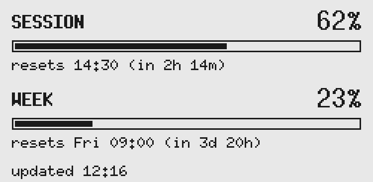
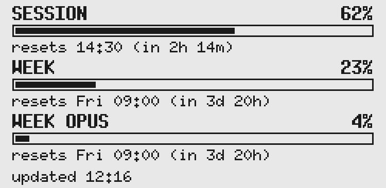
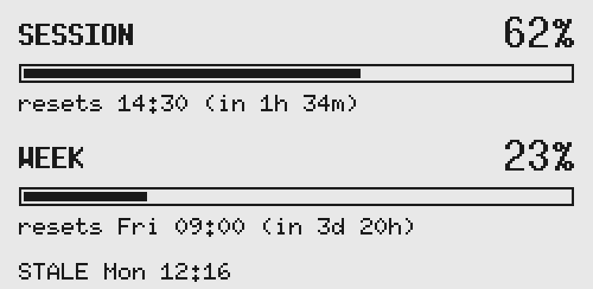
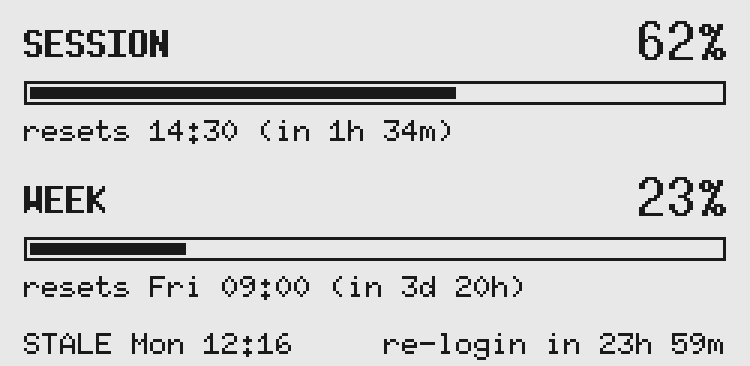
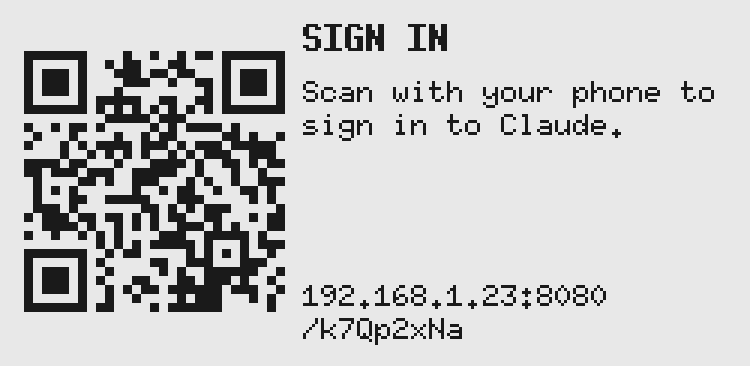
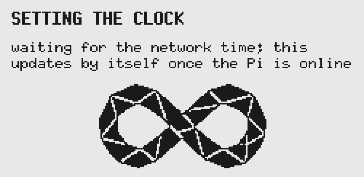
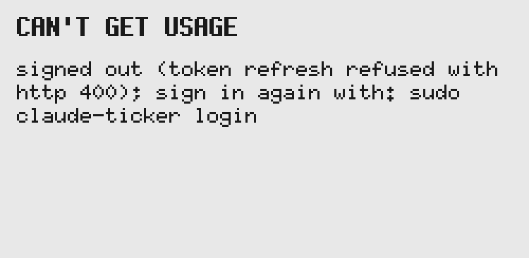

# claude-ticker

**A small e-paper display that shows how much of your Claude plan you've used.**

<p align="center">
  
</p>

If you use Claude on a **Pro or Max** plan, you have a 5-hour session limit and a weekly limit. claude-ticker shows both on a 2.13" e-paper screen next to your desk. It shows how much of each you've used, when each one resets, and a weekly limit for a specific model (such as Opus) if your plan has one. It updates every 5 minutes.

It runs on a Raspberry Pi Zero W or Zero 2 W with a Waveshare e-paper HAT, which is a screen that plugs straight onto the Pi's pins. The Pi and screen together cost roughly US$35–45. E-paper keeps its image with no power and doesn't glow, so the display stays readable all day without lighting up your desk.

> [!NOTE]
> This is an unofficial hobby project, not affiliated with Anthropic. It reads the same **undocumented** usage endpoint that Claude Code's `/usage` command uses, and signs in the same way Claude Code does. Anthropic can change either at any time, which would break this until it's updated.

## Contents

- [What it shows](#what-it-shows)
- [What you need](#what-you-need)
- [Setup](#setup)
  - [1. Assemble the hardware](#1-assemble-the-hardware)
  - [2. Install Raspberry Pi OS](#2-install-raspberry-pi-os)
  - [3. Connect to the Pi](#3-connect-to-the-pi)
  - [4. Build claude-ticker on your computer](#4-build-claude-ticker-on-your-computer)
  - [5. Install it on the Pi](#5-install-it-on-the-pi)
  - [6. Sign in to Claude](#6-sign-in-to-claude)
- [Settings](#settings)
- [Everyday use](#everyday-use)
- [Troubleshooting](#troubleshooting)
- [Privacy and security](#privacy-and-security)
- [Development](#development)

## What it shows

| Screen | When you see it |
|---|---|
|  | **Dashboard.** Your 5-hour **session** and **weekly** usage, each with a bar and the time it resets. The bottom line shows when the numbers were last fetched. |
|  | **Dashboard with a model limit.** If your plan has a separate weekly limit for one model, such as Opus, it gets a third row. |
|  | **STALE.** The Pi hasn't been able to fetch new numbers for a while (15 minutes by default), usually because of a Wi-Fi drop. It keeps showing the last numbers and marks when they're from. It clears by itself at the next successful fetch. |
|  | **re-login in ...** The Pi's sign-in expires in less than 5 days. [Sign in again](#signing-in-again) before then. |
|  | **SIGN IN.** The Pi isn't signed in to Claude. Scan the QR code with your phone to sign in. See [step 6](#6-sign-in-to-claude). |
|  | **SETTING THE CLOCK.** Shown briefly after the Pi turns on. The Pi has no battery-backed clock, so it waits until it has the correct time from the internet. |
|  | **CAN'T GET USAGE.** Something needs your attention. The message says what went wrong and usually how to fix it. See [Troubleshooting](#troubleshooting). |

The numbers match what Claude Code's `/usage` command and the usage page on claude.ai show. Times are in 24-hour format, in your timezone.

## What you need

### Hardware

| Part | Notes |
|---|---|
| **Raspberry Pi Zero W** or **Zero 2 W** | The Zero 2 W is faster and is the better choice if you're buying new. Either works. Buy the **WH** version ("with header") to skip soldering. |
| **Waveshare 2.13" e-Paper HAT**, 250×122, black and white | Revisions V3 and V4 work as-is; current stock is V4. A V2 needs a one-line change (see [AGENTS.md §6](AGENTS.md#6-hardware)). Don't buy the three-colour (red or yellow) versions. |
| **microSD card**, 8 GB or larger | |
| **5 V micro-USB power supply** | The official Raspberry Pi Zero supply (5.1 V, 2.5 A) is ideal. |
| **2×20 male pin header** | Only if your Pi doesn't already have one (non-WH versions). Needs a soldering iron. |
| A 3D-printed case *(optional)* | Designs are in [hardware/case/](hardware/case/). |

You'll also need a **2.4 GHz Wi-Fi network**; the Zero boards don't support 5 GHz.

### Accounts

- A **Claude Pro or Max** subscription. Free accounts and API (Console) keys aren't supported.

### On your computer (macOS or Linux)

You'll build the program on your computer and copy it to the Pi. The Pi Zero is too slow to build it itself.

- [Raspberry Pi Imager](https://www.raspberrypi.com/software/), to set up the SD card.
- [Rust](https://rustup.rs/). Install it with:

  ```sh
  curl --proto '=https' --tlsv1.2 -sSf https://sh.rustup.rs | sh
  ```

- **Docker**, which the cross-compiler uses to build for the Pi: [Docker Desktop](https://www.docker.com/products/docker-desktop/) on macOS, or Docker Engine on Linux. Podman also works; see [step 4](#4-build-claude-ticker-on-your-computer).
- `git`, to download this project.

## Setup

Setup takes about 30–45 minutes, most of it waiting for things to download and build.

### 1. Assemble the hardware

1. **If your Pi has no pin header**, solder the 2×20 header on first, with the long pins pointing up on the side with the chips.
2. **Push the e-paper HAT onto the header** so the HAT sits directly over the Pi, with its outline lined up with the Pi's. Press it down evenly until all 40 pins are fully seated. The HAT's own small cable connector isn't used.
3. Don't plug in the power yet.

### 2. Install Raspberry Pi OS

1. Insert the microSD card into your computer and open **Raspberry Pi Imager**.
2. Choose:
   - **Device:** *Raspberry Pi Zero* (for the Zero W) or *Raspberry Pi Zero 2 W*.
   - **Operating system:** *Raspberry Pi OS (other)* → **Raspberry Pi OS Lite**. The Lite version has no desktop, which the Pi doesn't need.
     - Zero W: choose the **32-bit** version. It's the only one that runs on it.
     - Zero 2 W: choose the **64-bit** version.
   - **Storage:** your microSD card.
3. When Imager offers **OS customisation**, accept it and fill in the following (the exact screens vary between Imager versions):
   - **Hostname:** for example `claude-ticker`. You'll use this to find the Pi on your network.
   - **Username and password:** choose your own. You'll use them to log in to the Pi.
   - **Wireless LAN:** your Wi-Fi name and password, and your country.
   - **Locale settings:** your timezone. Reset times are shown in this timezone.
   - **SSH:** turn it on, with password authentication.
4. Write the card, put it in the Pi, and plug in the power. The first boot takes a few minutes. The e-paper screen stays blank for now; that's expected.

### 3. Connect to the Pi

From a terminal on your computer, log in to the Pi over SSH. Replace `you` with the username you chose in Imager, and `claude-ticker` with the hostname if you picked a different one:

```sh
ssh you@claude-ticker.local
```

Type `yes` if asked whether to trust the host, then your password. You're in when the prompt changes to something like `you@claude-ticker:~ $`.

Now check which version of the program the Pi needs:

```sh
dpkg --print-architecture
```

Remember the answer, `armhf` or `arm64`, for the next step.

| Answer | Your setup | Build target for step 4 |
|---|---|---|
| `armhf` | 32-bit Raspberry Pi OS (any Zero W, or a Zero 2 W on 32-bit) | `arm-unknown-linux-gnueabihf` |
| `arm64` | 64-bit Raspberry Pi OS (Zero 2 W) | `aarch64-unknown-linux-gnu` |

### 4. Build claude-ticker on your computer

Open a **new terminal on your computer** (not the SSH session), and make sure Docker is running.

1. Download this project and install `cross`, a tool that builds Rust programs for other kinds of computers:

   ```sh
   git clone https://github.com/clements604/claude_usage_tracker.git
   cd claude_usage_tracker
   cargo install cross
   ```

2. Build it for the Pi. Set `TARGET` to the build target from the table in step 3:

   ```sh
   TARGET=arm-unknown-linux-gnueabihf     # or: TARGET=aarch64-unknown-linux-gnu
   CARGO_TARGET_DIR=target/cross cross build --release --features epd --target $TARGET
   ```

   The first build downloads a build image and takes several minutes. Later builds are much quicker. If you use Podman instead of Docker, put `CROSS_CONTAINER_ENGINE=podman` in front of the `cross` command.

3. Copy the program and the installer to the Pi, using your username and hostname:

   ```sh
   scp -r target/cross/$TARGET/release/claude-ticker deploy you@claude-ticker.local:
   ```

### 5. Install it on the Pi

Back in the **SSH session on the Pi**, run the installer:

```sh
sudo ./deploy/install.sh ./claude-ticker
```

The installer:

- **Turns on SPI**, the connection the screen uses. Raspberry Pi OS has it off by default. The installer edits `/boot/firmware/config.txt` and saves a backup next to it first.
- Copies the program to `/usr/local/bin/claude-ticker`.
- Creates the settings file `/etc/claude-ticker/config.toml`. An existing one is never overwritten.
- Sets claude-ticker up as a background service that starts every time the Pi turns on, and starts it.

If the installer ends with **"SPI was just enabled; reboot for the display to work"**, restart the Pi:

```sh
sudo reboot
```

Your SSH session disconnects. Wait a minute, then reconnect with the same `ssh` command if you need it again.

Within a minute or two of the Pi starting, the screen shows **SETTING THE CLOCK** briefly, then **SIGN IN** with a QR code.

### 6. Sign in to Claude

The Pi needs to sign in to your Claude account once. After that it keeps itself signed in.

**With your phone (easiest):**

1. Make sure your phone is on the **same Wi-Fi network** as the Pi.
2. Scan the QR code on the e-paper screen with the phone's camera and open the link.
3. On the page that opens, tap **Open Claude sign-in**, sign in to Claude, and approve access.
4. Claude shows a code. Copy it, switch back to the first tab, paste the code, and tap **Finish**.

The screen switches to your usage within a few seconds.

**Or from the terminal:** in the SSH session, run:

```sh
sudo claude-ticker login
```

It prints a link. Open it on any device, sign in and approve, then paste the code Claude shows back into the terminal. The display picks up the sign-in by itself within a few minutes.

## Settings

Settings live in `/etc/claude-ticker/config.toml` on the Pi. Every setting is optional; the defaults suit most people. To change one, edit the file on the Pi:

```sh
sudo nano /etc/claude-ticker/config.toml
```

Save with **Ctrl+O**, **Enter**, then exit with **Ctrl+X**. Apply the change with:

```sh
sudo systemctl restart claude-ticker
```

| Setting | Default | What it does |
|---|---|---|
| `timezone` | the Pi's timezone | The timezone for reset times, for example `"America/New_York"` or `"Europe/Berlin"` ([list of names](https://en.wikipedia.org/wiki/List_of_tz_database_time_zones)). It must be near the top of the file, above `[account]`. |
| `sign_in_port` (under `[account]`) | `8080` | The network port for the phone sign-in page. `0` turns the QR code sign-in off. |
| `poll_seconds` (under `[display]`) | `300` | How often to fetch usage, in seconds. The minimum is 60. |
| `stale_minutes` (under `[display]`) | `15` | Mark the numbers **STALE** if they haven't updated for this many minutes. |
| `full_refresh_every` (under `[display]`) | `12` | How many quick updates between full screen refreshes, which clear faint ghosting. |
| `flipped` (under `[display]`) | `false` | Set to `true` to turn the image upside down, if the Pi is mounted that way up. |

For example, to set your timezone and turn the image upside down:

```toml
timezone = "Europe/London"

[display]
flipped = true
```

## Everyday use

Once it's set up there's nothing to do. claude-ticker starts by itself whenever the Pi has power, and recovers by itself from Wi-Fi drops and power cuts.

What's normal:

- **The screen flashes black and white about once an hour, and at midnight.** That's a full refresh, which clears the faint "ghost" images e-paper builds up. Other updates are quick and don't flash.
- **The screen keeps its last image when the Pi is unplugged.** E-paper needs no power to hold an image.

### Signing in again

The Pi's sign-in lasts a long time but not forever. When it's less than 5 days from expiring, the bottom right of the screen counts down: **re-login in 4d 23h**. To renew it, run this in an SSH session on the Pi:

```sh
sudo claude-ticker login
```

If you let it expire, the **SIGN IN** QR code appears again. Scan it as in [step 6](#6-sign-in-to-claude).

### Useful commands

Run these in an SSH session on the Pi.

| Command | What it does |
|---|---|
| `sudo claude-ticker --check` | Fetches usage once and prints it, with the date the sign-in expires. It doesn't touch the screen. |
| `systemctl status claude-ticker` | Shows whether the service is running. |
| `journalctl -u claude-ticker -f` | Shows live log messages. Press **Ctrl+C** to stop. |
| `sudo systemctl restart claude-ticker` | Restarts the service, for example after changing settings. |
| `sudo claude-ticker login` | Signs in again. |

### Updating

To install a newer version, pull the latest code on your computer, then repeat [step 4](#4-build-claude-ticker-on-your-computer) and [step 5](#5-install-it-on-the-pi):

```sh
git pull
CARGO_TARGET_DIR=target/cross cross build --release --features epd --target $TARGET
scp -r target/cross/$TARGET/release/claude-ticker deploy you@claude-ticker.local:
# then on the Pi:
sudo ./deploy/install.sh ./claude-ticker
```

The installer keeps your settings and sign-in.

### Uninstalling

On the Pi:

```sh
sudo systemctl disable --now claude-ticker
sudo rm /etc/systemd/system/claude-ticker.service /usr/local/bin/claude-ticker
sudo rm -rf /etc/claude-ticker /var/lib/claude-ticker /var/lib/private/claude-ticker
sudo systemctl daemon-reload
```

The last line deletes your settings and the Pi's sign-in.

## Troubleshooting

Start with the logs. They usually say exactly what's wrong:

```sh
journalctl -u claude-ticker -n 50
```

<details>
<summary><b>The screen stays blank</b></summary>

- Check that the service is running: `systemctl status claude-ticker`.
- Check that SPI is on: `ls /dev/spidev0.0` should print the name back. If it says "No such file or directory", re-run the installer and reboot.
- Make sure the HAT is pressed fully onto all 40 pins and sits over the Pi, not hanging off the side.
- If the Pi has never shown anything, run `sudo claude-ticker --check` to see whether the program itself works.

</details>

<details>
<summary><b><code>Failed to execute /usr/local/bin/claude-ticker: No such file or directory</code></b></summary>

The program was built for the wrong kind of Raspberry Pi OS (32-bit vs 64-bit), even though the file exists. Run `dpkg --print-architecture` on the Pi, rebuild with the matching target from [step 3](#3-connect-to-the-pi), copy it over and re-run the installer.

</details>

<details>
<summary><b><code>failed to connect to the docker API</code> when building</b></summary>

Docker isn't running. Start Docker Desktop (macOS), or run `sudo systemctl start docker` (Linux), and try again. If you use Podman, put `CROSS_CONTAINER_ENGINE=podman` in front of the `cross` command.

</details>

<details>
<summary><b><code>GLIBC_2.25' not found</code> when building</b></summary>

`cross` tried to reuse files built by a normal `cargo build`. Include `CARGO_TARGET_DIR=target/cross` in the build command, as shown in [step 4](#4-build-claude-ticker-on-your-computer).

</details>

<details>
<summary><b>The screen says SETTING THE CLOCK and never changes</b></summary>

The Pi can't reach the internet to get the time. Check that it's on Wi-Fi (`ping -c 3 1.1.1.1`). The Zero boards only support **2.4 GHz** Wi-Fi. To change the Wi-Fi settings, run `sudo nmtui`, or re-image the SD card with the right details.

</details>

<details>
<summary><b>The QR code page won't open on my phone</b></summary>

- Your phone must be on the same Wi-Fi network as the Pi, not mobile data or a guest network. Guest networks usually block devices from reaching each other.
- The page only exists while the QR code is on screen, and its address changes every time it appears. Scan the code that is showing now.
- If it still won't work, sign in from the terminal instead: `sudo claude-ticker login`.

</details>

<details>
<summary><b>The numbers say STALE</b></summary>

The Pi couldn't fetch new numbers recently, usually because of a Wi-Fi drop. It keeps trying and clears the warning by itself. If it lasts, check the logs and the Wi-Fi. After about 90 minutes without an update, the numbers are replaced by an error screen, so you never see old numbers presented as current.

</details>

<details>
<summary><b>"usage response has no session or weekly limit"</b></summary>

Anthropic has probably changed the undocumented usage endpoint. Check this repository for an update, or open an issue.

</details>

<details>
<summary><b>The image is upside down</b></summary>

Set `flipped = true` under `[display]` in the [settings](#settings) and restart the service.

</details>

<details>
<summary><b>Faint leftover images on the screen</b></summary>

That's "ghosting", and it's normal for e-paper. It clears at the next full refresh, which happens about once an hour.

</details>

## Privacy and security

- **Only usage numbers are fetched.** claude-ticker never reads your conversations, prompts, or any other account content.
- **Your sign-in stays on the Pi.** It's stored in `/var/lib/claude-ticker/credentials.json`, readable only by the service. It's never shown on screen or written to the logs.
- **The sign-in page only exists while the QR code is on screen.** It's only reachable on your local network, at a random address that changes every time, and it accepts one sign-in.
- **No tracking.** The only network traffic is to Anthropic (usage and sign-in), plus the standard time sync.
- The service runs as a restricted system user with no access to your home folder.

<details>
<summary><b>Advanced: reuse Claude Code's sign-in from a Mac</b></summary>

Instead of signing in on the Pi, you can copy Claude Code's sign-in from a Mac. Every renewal **replaces** the sign-in token, so the Pi and the Mac must not share one sign-in, or they'll keep logging each other out:

1. On the Mac: `security find-generic-password -s "Claude Code-credentials" -w > credentials.json && chmod 600 credentials.json`
2. Copy `credentials.json` to the Pi and install it: `sudo ./deploy/install.sh ./claude-ticker ./credentials.json`
3. Back on the Mac, run `/login` in Claude Code so the Mac gets a fresh sign-in of its own.
4. Delete `credentials.json` from both machines (the installed copy lives in `/var/lib/claude-ticker`). Treat it like a password.

</details>

## Development

You don't need a Pi to work on claude-ticker. The display code can draw to PNG files or to a desktop window that behaves like the panel.

```sh
cargo test                                                        # run the tests
cargo run --example preview --features preview -- 62 23 4 out/    # PNGs of every screen
```

The preview command draws every screen with session 62%, week 23% and model 4% into `out/`.

### Desktop simulator

The simulator runs the real program loop in a window, with fake usage numbers you control from the keyboard. It needs SDL2:

```sh
# macOS
brew install sdl2
export LIBRARY_PATH="$(brew --prefix)/lib:$LIBRARY_PATH"
# Fedora
sudo dnf install SDL2-devel
# Debian / Ubuntu
sudo apt install libsdl2-dev

cargo run --example simulator --features simulator -- --poll-seconds 5
```

| Key | Action |
|---|---|
| ↑ / ↓ | Session usage +5% / −5% |
| ] / [ | Week usage +5% / −5% |
| → / ← | Move time forward / back one hour |
| O | Show or hide the Opus row |
| X | Simulate network failures |
| A | Sign out (shows the QR screen); press again to finish a simulated sign-in |
| L | Simulate a sign-in that expires in 2 days |
| W | Simulate an unsynced clock |
| Space | Fetch now |
| F | Force a full refresh |
| Esc | Quit |

### Against the real API

To sign in and fetch real numbers from your computer, make a config file with `credentials = "path/to/credentials.json"` under `[account]`, then:

```sh
cargo run --features net -- login my-config.toml
cargo run --features net -- --check my-config.toml
```

### Contributing

[AGENTS.md](AGENTS.md) has the full design notes: architecture, the rules for reading the usage data, e-paper layout limits, and the checks every change must pass. Please read it before opening a pull request.
